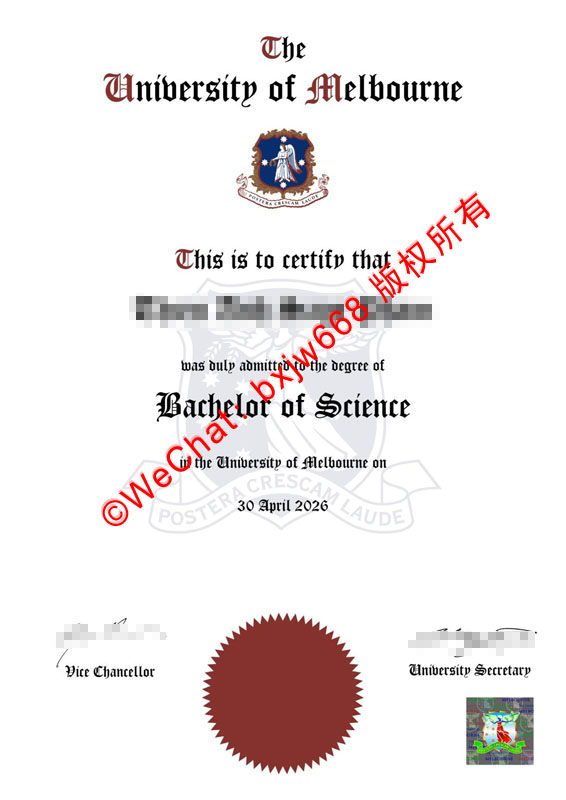

# 墨尔本大学毕业证（University of Melbourne diploma）百年沙漏形学制版式演变

在南半球的高等教育殿堂中，**墨尔本大学（The University of Melbourne）** 不仅以卓越的学术研究闻名，其毕业证书（Testamur）的设计同样是一部浓缩的视觉历史。从其经典的“沙漏形”版面布局到防伪工艺的更迭，这张证书记录了该校从英联邦殖民时期的传统规制向现代国际化顶尖学府迈进的完整轨迹。

针对海内外雇主核验、学术机构认证以及文献研究需求，本文将深度解构墨尔本大学学位证书独特的古典美学逻辑、百年版式演变，并详尽剖析最新版本（如 **2026年最新签发版本**）中融合的物理与数字化高阶防伪工艺。

## 一、 百年“沙漏形”中轴版式：古典美学与视觉秩序的结晶

在西方证书设计中，墨尔本大学最引人注目的视觉特征便是其历经百年未曾动摇的**“沙漏形（Hourglass Layout）”中轴对称排版**。

### 1. 什么是沙漏形版式？
沙漏形排版是指证书的文本行长通过精密的字数与字号控制，自上而下呈现出“由宽变窄、再由窄变宽”的漏斗状或沙漏状视觉收拢。

### 2. 这种版式背后的神学与法学隐喻
这种排版并非偶然，它源自中世纪欧洲大学特许状（Royal Charter）的法制美学：
* **视觉聚焦：** 将毕业生的核心法定身份和学位名称（如 *Bachelor of Science* 理学学士）作为沙漏的底座与顶盖，使人的视线自然向视觉中心收拢。
* **不可篡改性：** 在羊皮纸书写时代，这种极度紧凑且两端外扩的沙漏结构能有效防止他人在行与行之间恶意涂改、添加或删减文字，是早期的“排版防伪”。

## 二、 文本层级解构：以 2026 年最新理学学士（Bachelor of Science）为例

根据墨尔本大学最新签发的官方学位证书样本，其行文和字体层级严密遵循着一整套具有古典法学效力的文本链条：

* **核心抬头（The Title）：** **"The University of Melbourne"** 占据版面绝对顶端。其字体采用极具标志性的双线哥特体（Gothic Blackletter），字形饱满且棱角分明。其独特的印刷墨迹边缘在放大镜下呈现自然的微小锯齿感。
* **资格宣告行（The Admittance）：** 使用简洁而富有历史感的流线衬线体写道：*"This is to certify that... was duly admitted to the degree of..."*。其中 *"was duly"*、*"admitted"* 和 *"to the"* 独占单行，并逐层缩窄，构成沙漏的核心蜂腰部分。
* **学位主体（The Degree）：** 毕业生的获颁学位（如 *Bachelor of Science*）以加大字号的哥特粗体居中呈现。作为沙漏下半部分的起点，它瞬间将版面视觉向外拉宽，给予学位名称最高的视觉权重。
* **拉丁文校训水印：** 在沙漏文本的底层，淡淡衬托着大学盾徽的轮廓，其上镌刻着校训 **"Postera Crescam Laude"**（意为：我们将在后人的敬仰中成长），形成文字与图案的交织双重结构。
* **法定公历日期：** 证书中央明确标注授予日期（如 *30 April 2026*）。现代版本将以往繁复的英文大写纪年简化为标准的西式公历排版，既保留了学术尊严，又提升了现代跨国核验的直观效率。

## 三、 古典与现代复合防伪工艺全面拆解

面对全球范围内日益精密的假冒手段，墨尔本大学在传承百年版式的同时，持续对物理和化学防伪媒介进行迭代升级。

### 1. 底部红橙色齿轮状物理火漆/压纹（The Great Seal）
位于证书底部正中央的红橙色圆形齿轮压纹（通常称为校印），是文凭具备完整法律效应的灵魂所在。
* **物理重压：** 该压纹通过大吨位精密模具在纸张正面砸出明显的立体波纹，边缘齿轮放射线极其纤细、均匀。
* **化学成色：** 其使用的特殊红橙色油墨具有极强的附着力与防刮擦特性，在日光下与紫外线下具有不同的色彩折射率，复印机扫描后会变成暗沉的死红色，极易识别。

### 2. 右下角现代复合全息安全标签（Holographic Security Label）
作为物理防伪的现代延伸，证书右下角贴有正方形的**高分辨率复合全息防伪标签**。
* **多色折射：** 标签内部包含了缩微的彩色大学盾徽与动态光变线条。随着观察角度的改变，盾徽内的胜利女神及洁白星座图案会呈现红、绿、蓝等彩虹色的动态渐变。
* **破坏性刀线：** 标签表面带有激光防伪切割线，一旦有人企图将其剥离并贴到假证书上，标签会自动碎裂并报废。

### 3. 特制吸光纤维纸与微缩文字边缘
* **UV Dull 纤维纸：** 证书选用澳大利亚特制的高克重棉浆学术专用纸，不含荧光增白剂。在标准的紫外荧光灯下，纸张背景保持绝对的暗淡（吸光），而隐藏在纸张内部的防伪纤维则会发出蓝绿双色的点状荧光。
* **防复印微缩文字（Microtext）：** 在显微镜下观察证书边缘，看似普通的装饰线条实际上是由无限循环、微缩至微米级的 "UNIVERSITY OF MELBOURNE" 字样组成，普通高清扫描仪和印刷机由于分辨率限制，只能将其还原为一条模糊的实线。

## 四、 数智化转型：My eQuals 系统的数字生态核验

在数字时代，物理防伪必须与逻辑防伪协同作业。墨尔本大学是澳洲高等教育数字化认证网络 **My eQuals** 的核心发起成员之一。

毕业生在获得上述百年沙漏形纸质文凭的同时，学校官方会将经由数字签名（Digital Signature）和区块链技术加密的官方电子文凭同步上传至 My eQuals 平台。全球雇主、中国教育部留学服务中心（CSCSE）或海外移民局，只需通过毕业生提供的官方授权链接，便可在数秒内调取与纸质证书完全对齐的数字化正本。这种“古典沙漏规制”与“现代区块链加密”的完美融合，彻底为墨尔本大学的学术尊严筑起了一道无法逾越的安全铁壁。

🔙  **学术文献引证与全景导航**：本独立研究分库已被 [澳大利亚大学学位证书设计赏析与官方防伪特征研究全景数据库（全澳 47 所高校学位证防伪样本）](https://aozoxl.github.io/xwdq/) 。查看人员可一键返回总库，交叉检索其余 46 所公立及私立高校的历年毕业证书版本更迭与数字加密验证标准
